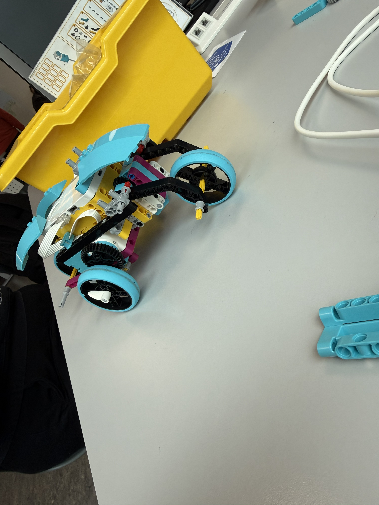
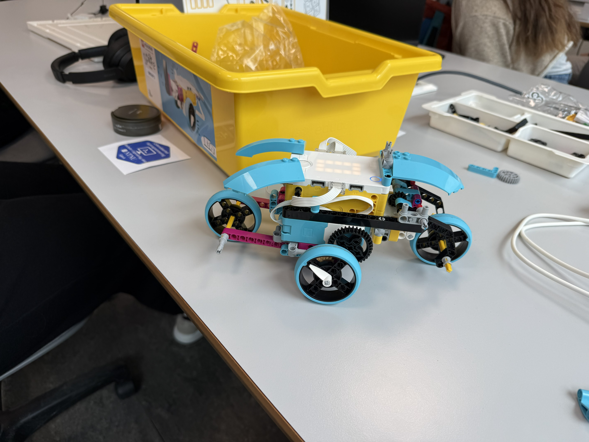

## This file is for explanations and reflections on my work with Lego Spike in the subject IDATG1004 

Pictured below is the first version of the Lego Spike car that my team and I developed in the subject Teambased Collaboration. This version was built and coded by us using Python to solve a few different tasks, first of them being that we simply needed to have it drive in a rektangle. This introduction project taught us the basics of working with the Lego Spike Module; the simple mechanics of building the car, and the functions unique to the Lego Spike code language - as it works on the syntax of Pythin with it's own functions and conventions made specifically for the Spike car.

The project started with a simple division of the work, something I took initiative with to figure out who on our group were best suited for which task. While we all ended up having a hand in every part of the project from the building to the coding, this initial division allowed us to effectively move forwards before generalising and sharing our progress later on. My first task was to take charge of building the car itself, as I was the one most familiar with building Lego and the necessary mechanics to build a car that was not only functional, but stable and consistent.

As we neared the end of the first project, this became essential along with tweaking the code and using a Trial and Error method to figure out the correct values for motor-speed and time to run, as we needed the car to make precise 90-degree turns for the rectangle. Managing this made the following tasks much easier as we already had the precision necessary to fulfill their requirements, thereby only needing to modify the code itself so as to complete the next task.

The following tasks were largely made to be a continuation of the first; the second was to make the bot work as a lawn mower, using a simple but effective pattern of movement with the ability to sense obstructions in front and move around them. Here I took a more active role in the coding segment as the car was largely built and ready, requiring only that we add an ultra-sound sensor to the front. This task taught me more about the necessity of knowing the specs of the technology you work with when you code for it, as there were 'quirks' that I simply wouldn't have thought of from the code alone. For example, the ultrasound-sensor was there to detect how far something was from the sensor, but whenever there was nothing close enough to return a value, it simply returned a value of "-1", thereby forcing us to compensate with conditions for whenever the sensor read anything anything beneath a value of 0mm away.

## Final Project, Autumn 2026
The final project our team had to work on during the Autumn semester of 2026 involved working as a team to develop a prototype product that aimed to solve a societal issue, based around the UN Sustainability Goals. This work was then to be logged, documented and explained in a report along with giving a presentation on the completed work in front of the whole course.

Early on in the process, my group worked out the idea we wished to develop: Considering the major issue of ambulance availability and response time in the more remote parts of Norway, we decided on the idea of creating a prototype Health-Bot meant to be a live-in health assistant for people at special risk, along with living far outside the usual ranges of the Hospital. Such a bot was then supposed to be able to monitor the health of it's owner, delivering speedy emergency aid such as CPR in case of things such as heart failure, all while automatically calling for Emergency Services and giving accurate, relevant information to whomever arrived as first responder.

From the beginning of the project, I took on the responsibility of developing the prototype itself; The point of the prototype was for us to create something with the Lego Spike kit that could illustrate the idea and/or theoretical application of our project. To accomplish this, I first worked out the exact points that the prototype had to cover.
1. The base function was the CPR movement, giving the robot the ability to simulate giving CPR in an emergency.
2. Secondary came a way to simulate it calling for emergency services.
3. Last was a rudimentary way to detect it's patient so it would know when to begin applying CPR and calling for help.

These functions were relatively simple to develop considering the work already done to complete the previous tasks. The base of our robot was altered, unnecessary parts removed and altered to make sure the build was entirely focused on the project we were developing. I could then move on to adding the CPR function, using a basic frame around a circular motor that transformed it's rotational motion into linear motion, then adding a makeshift 'piston' to the tip. I then attached the motor vertically on the bot, with the piston pointing down so that once the bot had moved itself above the patient, it could begin performing CPR.

The other functions were largely for show; having the bot flash messages on it's core and giving off beeping sounds served well enough to simulate an emergency call, especially as Lego Spike lacked more complicated functions I would have needed to do something more detailed. Similarly, I reused code from one of the earlier projects to have the robot use the ultrasound distance-sensor to simulate a more comprehensive sensor suite. It simply needed to see when something was in front of it and know to then stop, call for help and begin performing CPR. 

That was far from the only work done, of course - the main work of the project lied in the report we had to write for the final submission. This work posed challenges and frustrations throughout the whole process, which I learned a lot from.

The main problem was in team communication; While I had thought that our team was communicating well and all on the same page during meetings and Class Sessions, it turned out that we had some vastly different understandings of what was actually being agreed on, something all of us should have worked harder to ensure did not happen. For example was there misunderstandings in exactly how the work was divided, leaving me and another member to stress and get frustrated as we felt we were doing the vast majority of the work both in and outside of the report. Attempts to rectify this met varying success, but it remained an issue throughout the whole project.

Other issues cropped up with faulty understanding of the actual criteria for the report. My group and I had failed to read the presentations our teacher published, along with supplementary material, carefully enough to realise that there were extra, mandatory details that our report had to include - details that we had not been aware of until the last week before submission. While these details could have been communicated more efficiently, especially when certain details of the presentation were entirely incorrect based on the Teacher's own words, it ultimately stood as a failure on our part to be sufficiently diligent in our preparation.

