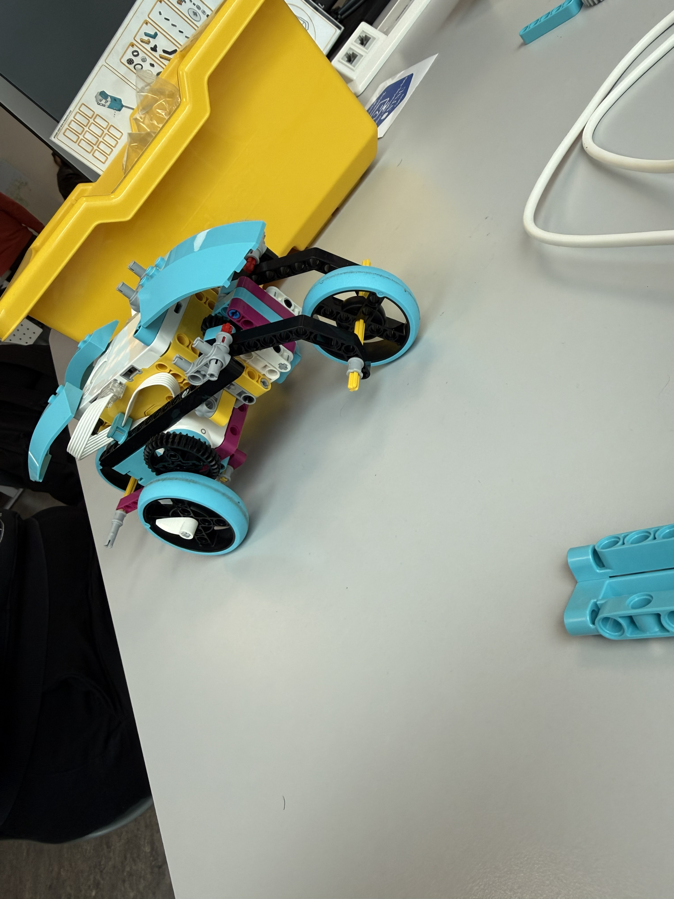
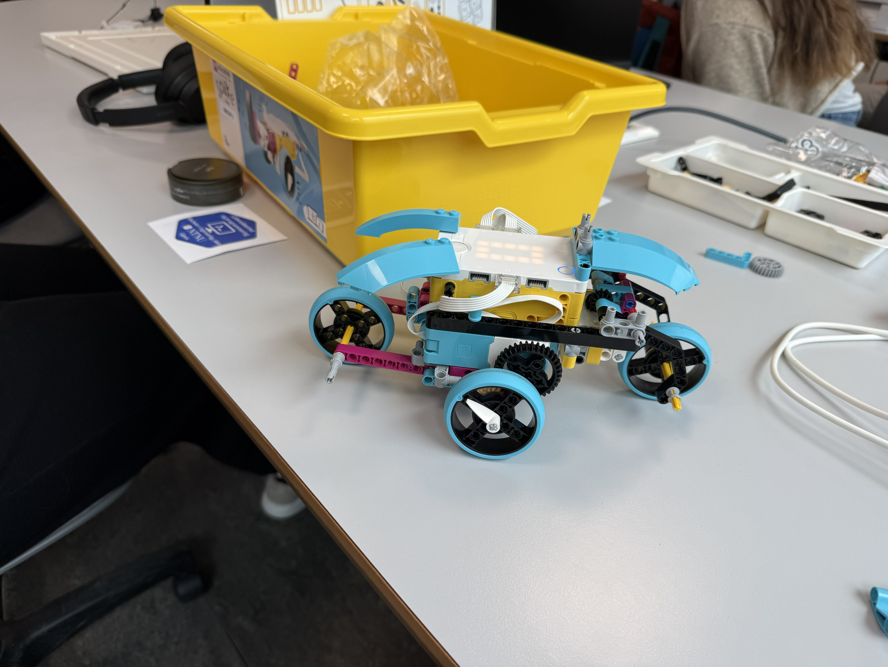

## This file is for explanations and reflections on my work with Lego Spike in the subject IDATG1004 

Pictured below is the first version of the Lego Spike car that my team and I developed in the subject Teambased Collaboration. This version was built and coded by us using Python to solve a few different tasks, first of them being that we simply needed to have it drive in a rektangle. This introduction project taught us the basics of working with the Lego Spike Module; the simple mechanics of building the car, and the functions unique to the Lego Spike code language - as it works on the syntax of Pythin with it's own functions and conventions made specifically for the Spike car.

The project started with a simple division of the work, something I took initiative with to figure out who on our group were best suited for which task. While we all ended up having a hand in every part of the project from the building to the coding, this initial division allowed us to effectively move forwards before generalising and sharing our progress later on. My first task was to take charge of building the car itself, as I was the one most familiar with building Lego and the necessary mechanics to build a car that was not only functional, but stable and consistent.

As we neared the end of the first project, this became essential along with tweaking the code and using a Trial and Error method to figure out the correct values for motor-speed and time to run, as we needed the car to make precise 90-degree turns for the rectangle. Managing this made the following tasks much easier as we already had the precision necessary to fulfill their requirements, thereby only needing to modify the code itself so as to complete the next task.

The following tasks were largely made to be a continuation of the first; the second was to make the bot work as a lawn mower, using a simple but effective pattern of movement with the ability to sense obstructions in front and move around them. Here I took a more active role in the coding segment as the car was largely built and ready, requiring only that we add an ultra-sound sensor to the front. This task taught me more about the necessity of knowing the specs of the technology you work with when you code for it, as there were 'quirks' that I simply wouldn't have thought of from the code alone. For example, the ultrasound-sensor was there to detect how far something was from the sensor, but whenever there was nothing close enough to return a value, it simply returned a value of "-1", thereby forcing us to compensate with conditions for whenever the sensor read anything anything beneath a value of 0mm away.
